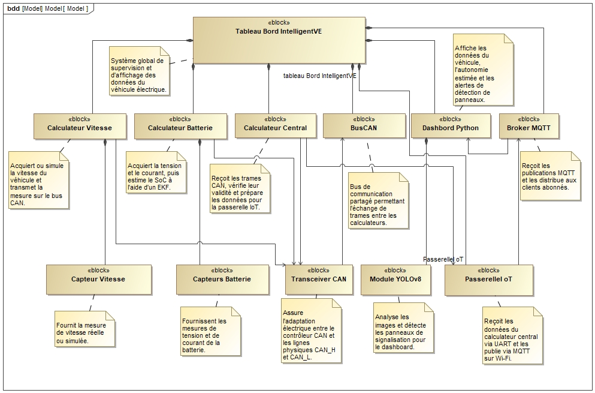

# EV-CORE — System Architecture

This section presents the system architecture of EV-CORE through its SysML structural diagrams.

## Block Definition Diagram (BDD)

The BDD presents the main system components and their structural relationships, including the embedded ECUs and communication elements.

## Internal Block Diagram (IBD)

The IBD illustrates the internal structure of the system, the interconnections between components and the data exchange interfaces.

---

These diagrams document the system-level architecture and serve as a reference for the ongoing implementation and integration phases.
