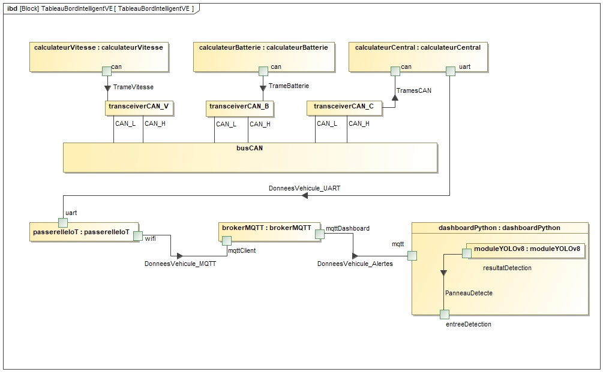

# EV-CORE — System Architecture

This section presents the system architecture of EV-CORE through its SysML structural diagrams and architectural overview.

## System Overview

EV-CORE is designed around a distributed multi-ECU architecture. Individual STM32 microcontrollers handle dedicated data acquisition tasks, while a central STM32 ECU validates and aggregates information exchanged over CAN.

The aggregated information is transmitted from the central STM32 to a Raspberry Pi 5 through UART. The Raspberry Pi 5 hosts the MQTT broker, enabling data distribution to the monitoring dashboard.

---

## Block Definition Diagram (BDD)

The Block Definition Diagram presents the main system components and their structural relationships, including the embedded ECUs and communication elements.

---

## Internal Block Diagram (IBD)

The Internal Block Diagram illustrates the internal structure of the system, the interconnections between components and the data exchange interfaces.

---

## System Communication Flow

### 1. Data Acquisition

- **STM32 ECU 1:** Acquires vehicle speed information.
- **STM32 ECU 2:** Acquires and/or estimates battery-related information, including State of Charge (SoC).

### 2. CAN Communication

The acquisition ECUs transmit their information through the CAN bus to the central STM32 ECU.

### 3. Central Processing

**STM32 ECU 3** acts as the central processing unit. It receives, validates and aggregates the information transmitted by the other ECUs.

### 4. UART Communication

The central STM32 transmits the aggregated data to the Raspberry Pi 5 through UART.

### 5. MQTT Infrastructure

The Raspberry Pi 5 hosts the MQTT broker and provides the messaging infrastructure for distributing the vehicle data.

### 6. Dashboard Monitoring

The dashboard receives and displays the information distributed through the MQTT infrastructure.

---

## Architectural Components

| Component | Role |
|---|---|
| STM32 ECU 1 | Vehicle speed data acquisition |
| STM32 ECU 2 | Battery data acquisition and SoC estimation |
| STM32 ECU 3 | Central data validation and aggregation |
| CAN Bus | Communication between STM32 ECUs |
| UART | Serial communication between central STM32 and Raspberry Pi 5 |
| Raspberry Pi 5 | Host platform for the MQTT broker |
| MQTT Broker | Message distribution |
| Dashboard | Data visualization and monitoring |

---

## Documentation Status

The architectural design is documented through SysML diagrams and textual descriptions. Implementation, testing and integration are progressively carried out as part of the EV-CORE project.

---

*EV-CORE — Embedded data acquisition, communication and monitoring architecture for electric vehicles.*
